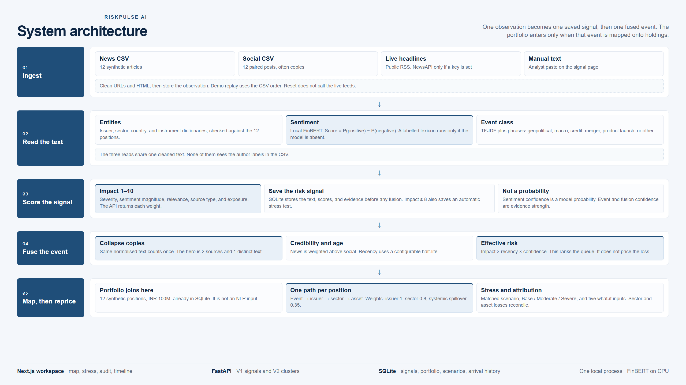

# RiskPulse AI - S&P Global & Crisil Campus Hackathon

Real-Time Financial Risk Intelligence & Portfolio Stress Testing

**Candidate Name:** Sudhanshu  
**College Email ID:** iit2024081@iiita.ac.in  
**College / Campus:** Indian Institute of Information Technology, Allahabad (IIITA)  
**Demo Video Link:** _Pending — record the walkthrough, upload it to YouTube as Unlisted, confirm it plays in a private window, then paste the URL here before the deadline._  
**Slide Deck Link (if hosted externally):** Not hosted externally. The submission deck is [docs/presentation.pdf](docs/presentation.pdf) in this repository.  

---

## 1. Project Overview / Problem Statement & Approach

Financial news and investor discussions arrive as high-velocity, unstructured text, while institutional risk decisions require issuer, sector, and portfolio context. **RiskPulse AI** bridges this gap by converting multi-source text streams (live RSS news feeds and synthetic market commentary) into structured, actionable risk signals and directly using those signals to perform dynamic portfolio scenario stress testing.

The prototype implements the mandatory **AI/NLP risk engine** and **Module B: Strategic Portfolio Stress Testing**. Key capabilities include:
- **Real-Time Source Fusion:** Live RSS news ingestion (BBC Business, CNBC Finance) with fallback handling, paired with synthetic local market discussions.
- **Explainable NLP Intelligence:** FinBERT transformer sentiment analysis alongside financial lexicon fallback, transparent entity extraction across portfolio issuers, and TF-IDF event classification.
- **Dynamic Risk Propagation & Exposure Mapping:** Multi-hop risk transmission graph tracking issuer, sector, and systemic risk spillover.
- **Portfolio Stress Testing Lab:** Interactive what-if simulation engine repricing a wholesale-banking portfolio (INR 100M across 12 positions and 5 asset classes) with customizable intensity shocks and asset-level loss reconciliation.
- **Institutional Analyst Dashboard:** Real-time risk feed, interactive transmission graph, currency toggle (₹ INR Cr ⇄ $ USD M), scenario comparison, and audit trail.

All portfolio positions, issuers, demo source records, sensitivities, and shocks are synthetic. Live publisher headlines retain publication dates and source URLs. The product supports explainable analyst triage and scenario comparison without proprietary or confidential data.

---

## 2. Architecture & Tech Stack



The application follows a decoupled client-server architecture:
- **Backend:** FastAPI (Python) exposes high-throughput REST endpoints (`/api/v2/dashboard`, `/api/health`, `/api/v2/what-if`, `/api/analyze`, `/api/stress-test`) with Pydantic schema validation.
- **Storage:** Local SQLite database managed via `backend/store.py` persisting risk signals, portfolio positions, scenarios, and stress test executions.
- **Frontend:** Next.js 15, React 19, TypeScript, and Vanilla CSS with Recharts for financial visual analytics, Lucide icons, and interactive SVG risk transmission maps.

| Layer | Implementation | Purpose |
|---|---|---|
| **Frontend** | Next.js 15, React 19, TypeScript, Vanilla CSS, Recharts, Lucide | Institutional dashboard, interactive risk graph, what-if sliders |
| **API Backend** | Python 3.10+, FastAPI, Pydantic, Uvicorn, httpx | High-performance REST endpoints, schema validation |
| **NLP Engine** | Hugging Face Transformers, FinBERT (`ProsusAI/finbert`), scikit-learn TF-IDF | Sentiment analysis, event categorization, entity mapping |
| **Finance Engine** | Custom exposure mapping & stress repricing formulas | Duration-based repricing, systemic spillover, loss reconciliation |
| **Data & Storage** | SQLite, CSV, JSON | Local persistent storage with deterministic replay |
| **Verification** | pytest (62 tests), production frontend build | Automated test coverage and regression prevention |

---

## 3. Dataset Used

See [data documentation](data/README.md) for complete schema descriptions.
- **Synthetic News (`data/news.csv`):** 12 financial news items covering geopolitical events, credit downgrades, mergers, and macroeconomic announcements.
- **Synthetic Social Posts (`data/social_posts.csv`):** 12 paired trader commentaries and social media discussions.
- **Wholesale Portfolio (`data/portfolio.csv`):** 12 diverse positions worth INR 100M across Energy, Technology, Financials, Healthcare, Consumer, and Industrials. Asset classes include corporate loans, government bonds, corporate bonds, equities, and derivatives.
- **Stress Scenarios (`data/scenarios.json`):** 5 institutional stress test scenarios with event-specific sector shock multipliers.
- **Risk Configuration (`data/risk_config.json`):** Configurable half-life decay, impact thresholds, and source reliability weights.

**Data Assumptions:** All data is synthetic and designed for educational/hackathon evaluation. Fictional news timestamps fall on 1 October 2026. No proprietary or confidential S&P Global or CRISIL data is used.

---

## 4. Quickstart & Installation

**Runtime:** Python 3.10+ (tested with Python 3.11 & 3.14) and Node.js 20+ (tested with Node 20 & 24) on Windows, macOS, or Linux.

### Step 1: Clone Repository
```bash
git clone https://github.com/sahsudhanshu/iiitallahabad-sudhanshu-hackathon.git
cd iiitallahabad-sudhanshu-hackathon
```

### Step 2: Backend Setup & Run
In your first terminal:
```bash
# 1. Create and activate virtual environment
python -m venv .venv

# Windows:
.\.venv\Scripts\activate
# macOS / Linux:
# source .venv/bin/activate

# 2. Install dependencies & initialize SQLite database
pip install -r requirements.txt
python scripts/seed_data.py

# 3. Start the FastAPI backend
uvicorn backend.main:app --host 127.0.0.1 --port 8000
```
* Backend health check: [http://127.0.0.1:8000/api/health](http://127.0.0.1:8000/api/health)
* Interactive Swagger API docs: [http://127.0.0.1:8000/docs](http://127.0.0.1:8000/docs)

### Step 3: Frontend Setup & Run
In a second terminal:
```bash
cd frontend
npm install
npm run dev
```
* Open the interactive dashboard in your browser at: **[http://127.0.0.1:3000](http://127.0.0.1:3000)**

### Automated Tests
Run the complete test suite (all 62 automated tests pass):
```bash
pytest backend/tests
```

---

## 5. Key Results & Domain Impact

### Key Results & Metrics
* **Deterministic baseline:** On the synthetic Helios Energy geopolitical case, raw impact is **9.78 / 10**, direct exposure is **INR 42.0M**, and weighted exposure is **INR 59.5M**. At moderate intensity the book moves from **INR 100.00M to INR 97.183M** (conditional loss **INR 2.817M**). At 1.5× intensity the conditional loss is **INR 4.226M**.
* **Local diagnostic, not a market test:** On 24 author-labelled synthetic records, event-label agreement is **100%** and sentiment-label agreement is **91.67%**. These records are small and correlated. They do not measure real-market accuracy.
* **Traceability:** Each conditional loss ties back to the source text, the path weights, and the scenario assumption. Confidence ranks the event. It is not used as a loss probability.

### Domain Impact
* **Event priority, not headline volume:** A copied social post is collapsed and does not raise confidence.
* **Exposure before the scenario:** An analyst can see the INR 42M direct and INR 59.5M weighted exposure before comparing shocks.
* **A loss that can be challenged:** Energy and the largest position reconcile to the portfolio total. Impact of 8 or above saves an automatic stress test. The what-if controls change assumptions, not the book. Display can switch between rupees and a USD scale.

### Deliverables & Reference Links
* **Architecture Diagram:** [docs/architecture.png](docs/architecture.png)
* **Presentation Deck (7 slides):** [docs/presentation.pdf](docs/presentation.pdf)
* **Dataset Documentation:** [data/README.md](data/README.md)
